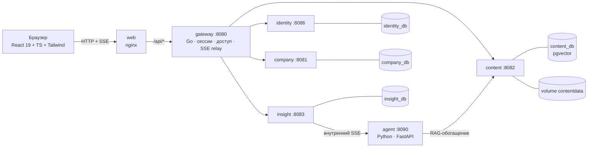

# Альфа Хак 2026 — новостная аналитика для крупного бизнеса

Персональная лента событий с разбором влияния на конкретную компанию. Пользователь видит не пересказ новости, а ответ на вопрос «что это значит для моего бизнеса»: подтверждённые факты и гипотезы со ссылками на источники, риски и возможности, позицию Альфа-Банка (только если она подтверждена аналитикой банка) и вывод AI.

Решение — монорепозиторий из шести сервисов, одного фронтенда и Python-агента. Всё поднимается одной командой на ноутбуке, без GPU и без локальных генеративных моделей: LLM вызывается через OpenAI-совместимый API организаторов.

> Дисклеймер: материалы решения носят информационный характер и не являются индивидуальной инвестиционной рекомендацией.

## Содержание

- [Что делает продукт](#что-делает-продукт)
- [Быстрый старт](#быстрый-старт)
- [Демо-аккаунты и данные](#демо-аккаунты-и-данные)
- [Сценарий демонстрации](#сценарий-демонстрации)
- [Требования к окружению](#требования-к-окружению)
- [Запуск для разработки](#запуск-для-разработки)
- [Переменные окружения](#переменные-окружения)
- [Архитектура](#архитектура)
- [Как устроены данные](#как-устроены-данные)
- [Лента и ранжирование](#лента-и-ранжирование)
- [Разбор события: поток SSE](#разбор-события-поток-sse)
- [Агент и работа с моделями](#агент-и-работа-с-моделями)
- [RAG по документам](#rag-по-документам)
- [Безопасность и модель доступа](#безопасность-и-модель-доступа)
- [Наблюдаемость и эксплуатация](#наблюдаемость-и-эксплуатация)
- [Тесты, линт и CI](#тесты-линт-и-ci)
- [Команды](#команды)
- [Структура репозитория](#структура-репозитория)
- [Ограничения и планы](#ограничения-и-планы)
- [Troubleshooting](#troubleshooting)
- [Ссылки](#ссылки)

## Что делает продукт

| Возможность | Как это работает |
| --- | --- |
| Лента событий по компании | Insight собирает новости из content-сервиса и ранжирует их по профилю компании: название, отрасль, регион, свежесть. У каждого события есть `relevance` и человекочитаемые `reasons`. |
| Фильтры и фасеты | Источники, темы, отрасли, период, сортировка, поиск. Фасеты считаются по несфильтрованному окну, поэтому список вариантов не «схлопывается» после выбора. |
| Разбор события | Кнопка «Разобрать событие» запускает задачу: агент строит структурированный инсайт и присылает прогресс по SSE. |
| Прозрачность выводов | Каждый факт и гипотеза несёт `source_ids`; валидатор не даёт вернуть вывод без источника. В панели разбора источники пронумерованы и кликабельны. |
| Позиция банка отделена от AI | `bank_view` показывается только при `used=true`, то есть когда тезис опирается на аналитику Альфа-Банка. Иначе блок скрывается, а не заполняется «общими словами». |
| Доступ по компаниям | Пользователь видит только компании, в которых состоит. Владелец компании управляет участниками, системный администратор — документами и грантами. |
| Профиль компании | Отрасль, регион, выручка, ОКВЭД, банковские продукты, люди и связи: группы компаний, общие люди, контрагенты по платежам. |

Скриншоты текущего интерфейса (перегенерируются `scripts/screenshots.mjs`, см. [docs/screenshots](docs/screenshots/README.md)): [лента](docs/screenshots/02-feed.png), [фильтры](docs/screenshots/03-filters.png), [разбор события](docs/screenshots/04-analysis.png), [профиль](docs/screenshots/05-profile.png), [участники компании](docs/screenshots/06-members.png).

## Быстрый старт

Нужен только Docker с Compose v2. Все команды — из корня репозитория.

```bash
cp .env.example .env
make demo
```

Что делает `make demo`:

1. собирает образы всех сервисов и web;
2. поднимает PostgreSQL (с pgvector), Redis, все Go-сервисы, Python-агента и web;
3. ждёт health-чеков;
4. загружает демо-данные: 7 компаний, людей, платежи и 4 новости;
5. создаёт две демо-учётные записи и печатает их.

Первый запуск занимает несколько минут: собираются Go-бинарники, фронтенд и Python-образ агента. Повторный — секунды.

Откройте <http://localhost:3000> и войдите как `demo-client@alfa.local` / `demo-password`.

Проверка, что стек жив:

```bash
curl -s http://localhost:8080/healthz
# {"service":"gateway","status":"ok"}
# если меняли GATEWAY_PORT — подставьте свой порт

curl -s http://localhost:3000/api/v1/news?limit=1 | head -c 200
```

Если порт занят, задайте в `.env` другой: `GATEWAY_PORT=18080`, `WEB_PORT=13000`. Эти же значения используют `make demo`, `make smoke` и `scripts/bootstrap-users.sh`.

Пересоздать демо с пустой базой:

```bash
make demo-reset
```

Пересоздать только учётные записи на уже поднятом стеке:

```bash
make demo-users
```

## Демо-аккаунты и данные

| Аккаунт | Роль | Компании |
| --- | --- | --- |
| `demo-admin@alfa.local` | `admin` | участник `magnit`, `severstal`, `sber` |
| `demo-client@alfa.local` | `analyst` | владелец `magnit`, `severstal` |

Пароль у обоих — `demo-password`. Переопределяется в `.env`:

```dotenv
DEMO_ADMIN_EMAIL=demo-admin@alfa.local
DEMO_CLIENT_EMAIL=demo-client@alfa.local
DEMO_PASSWORD=demo-password
DEMO_ADMIN_COMPANIES="magnit severstal sber"
DEMO_CLIENT_COMPANIES="magnit severstal"
```

Важно: роли не дают обхода списка компаний. Администратор тоже видит только те компании, где он участник; глобальные права у него есть лишь на документы, гранты `/api/v1/access` и управление компанией по id.

Демо-данные лежат в `seed/`:

- `companies.csv` — 7 компаний: Альфа-Банк, Магнит, Тандер, Яндекс, Северсталь, Sber, ЛУКОЙЛ;
- `people.csv` — люди компаний, `payments.csv` — платежи для графа связей;
- `news/sample.json` — 4 новости (РБК, Коммерсантъ, Ведомости, Интерфакс) с тегами и отраслями.

Полные датасеты хакатона импортируются тем же CLI:

```bash
go run ./services/company/cmd/seed \
  -file path/to/df_Uid_data_hack.csv \
  -people path/to/df_Fid_Uid_link_hack.csv \
  -payments path/to/payments.csv
```

## Сценарий демонстрации

1. Откройте <http://localhost:3000> — экран входа ([скриншот](docs/screenshots/01-login.png)).
2. Войдите как `demo-client@alfa.local` / `demo-password`.
3. В левой колонке выберите компанию «Магнит» — лента перестроится под её профиль ([скриншот](docs/screenshots/02-feed.png)).
4. Раскройте «Фильтры»: источники, темы, отрасли, период, сортировка, поиск. Выберите «Ведомости» или тег `логистика` и нажмите «Применить» ([скриншот](docs/screenshots/03-filters.png)).
5. Сбросьте фильтры и нажмите «Разобрать событие» на новости про Магнит.
6. Дождитесь результата: шаги (поиск источников, оценка влияния, анализ AI, проверка источников), затем панель разбора с фактами, гипотезами, рисками, возможностями, выводом AI и источниками ([скриншот](docs/screenshots/04-analysis.png)).
7. Обратите внимание: у каждого тезиса есть номера источников; блок «Позиция банка» виден только когда `bank_view.used=true`, то есть когда в evidence есть аналитика Альфа-Банка.
8. Переключитесь на «Северсталь» — лента и профиль компании меняются ([скриншот профиля](docs/screenshots/05-profile.png)).
9. Откройте «Участники»: владелец может добавлять пользователей по email и менять роли ([скриншот](docs/screenshots/06-members.png)).
10. Войдите как `demo-admin@alfa.local` и убедитесь, что список компаний у него другой — это проверка модели доступа, а не только UI-фильтр.

Если агент запущен в `AGENT_MODE=live`, шаги займут больше времени (внешний LLM), появится шаг «Догрузка контекста» (RAG). В демо по умолчанию `AGENT_MODE=stub`: детерминированный ответ без внешних вызовов.

## Требования к окружению

- Docker 24+ с Compose v2 (основной путь).
- 8 ГБ RAM: PostgreSQL, 4 Go-сервиса, web и Python-агент.
- 10 ГБ свободного диска на образы и volume PostgreSQL.
- Свободные порты: `3000` (web), `8080` (gateway), `8081`, `8082`, `8083`, `8086` (сервисы, только localhost), `5432` (PostgreSQL), `6379` (Redis).

Для разработки без Docker дополнительно: Go 1.26+, Node 24+, pnpm 11+, Python 3.13+, uv, golangci-lint, ruff. На NixOS всё это даёт `nix develop`.

Интернет нужен только для первой сборки образов и для `AGENT_MODE=live` (вызов LLM через API организаторов). Демо в `stub`-режиме работает полностью офлайн после сборки.

## Запуск для разработки

Инфраструктура в Docker, сервисы на хосте:

```bash
cp .env.example .env
make bootstrap   # go mod download, pnpm install, uv sync, .env
make infra       # postgres + redis
make migrate     # миграции всех сервисов
make seed        # демо-компании, люди, платежи, новости
make dev         # сервисы + web на хосте
```

Порты при `make dev`: web <http://localhost:5173>, gateway 8080, company 8081, content 8082, insight 8083, identity 8086, agent 8090.

С NixOS то же самое, но окружение поднимается одной командой:

```bash
nix develop
make bootstrap && make infra && make migrate && make seed && make dev
```

Отдельно агент:

```bash
cd services/agent
uv sync
uv run uvicorn app.main:app --reload --port 8090
```

## Переменные окружения

Полный список с дефолтами — в [`.env.example`](.env.example). Ключевые группы:

| Переменная | Назначение | По умолчанию |
| --- | --- | --- |
| `GATEWAY_PORT`, `WEB_PORT` | Внешние порты | `8080`, `3000` |
| `POSTGRES_USER/PASSWORD/DB`, `POSTGRES_PORT` | PostgreSQL | `postgres` / `postgres` / `postgres` / `5432` |
| `COMPANY_DATABASE_URL`, `CONTENT_DATABASE_URL`, `INSIGHT_DATABASE_URL`, `IDENTITY_DATABASE_URL` | Отдельная БД и роль на каждый сервис | `*_svc:*@localhost:5432/*_db` |
| `AGENT_MODE` | `stub` (без LLM) или `live` | `stub` |
| `ANALYZER_MODE` | Кто ведёт разбор: `agent` или встроенный стаб insight | `agent` |
| `LLM_BASE_URL`, `LLM_API_KEY`, `LLM_MODEL` | OpenAI-совместимый API организаторов | пусто |
| `LLM_FALLBACK_BASE_URL` | Резервный адрес, используется только если основной недоступен | пусто |
| `AGENT_TIMEOUT`, `AGENT_STEP_DELAY` | Таймаут задачи и пауза между шагами стаба | `120s`, `350ms` |
| `SESSION_COOKIE_NAME`, `SESSION_COOKIE_SECURE` | Cookie сессии | `alfa_session`, `false` |
| `IDENTITY_SESSION_TTL`, `IDENTITY_SESSION_PRUNE_INTERVAL` | Время жизни и уборка сессий | `168h`, `1h` |
| `IDENTITY_REGISTRATION_ENABLED` | Открыта ли регистрация | `true` (для демо) |
| `IDENTITY_LOGIN_MAX_ATTEMPTS`, `IDENTITY_LOGIN_WINDOW` | Rate limit логина | `5`, `15m` |
| `IDENTITY_INTERNAL_TOKEN` | Сервисный токен gateway → identity | `dev-internal-token` |
| `METRICS_ENABLED`, `METRICS_DIR` | Метрики LLM (JSONL) | `true`, `services/agent/metrics` |
| `ALFA_AGENT_STATE_DIR` | Каталог файлового состояния агента (бюджет) | `~/.alfa_agent` |
| `RAG_INDEX_DIR`, `RAG_DATA_DIR`, `RAG_USE_OCR` | RAG CLI | `.rag/index`, `data`, `False` |

Перед публичным развёртыванием обязательно задайте свои `POSTGRES_PASSWORD`, `IDENTITY_INTERNAL_TOKEN`, `SESSION_COOKIE_SECURE=true` и выключите `IDENTITY_REGISTRATION_ENABLED` после создания учётных записей.

## Архитектура



То же текстом:

```text
Браузер ──HTTP/SSE──▶ web (nginx) ──/api/*──▶ gateway
                                              ├─▶ identity  ─▶ identity_db
                                              ├─▶ company   ─▶ company_db
                                              ├─▶ content   ─▶ content_db (pgvector) + volume contentdata
                                              └─▶ insight   ─▶ insight_db, SSE-стрим
                                                     └──▶ agent (Python/FastAPI) ──RAG──▶ content
```

Принципы, которые проверяются кодом и ревью:

- **web общается только с gateway.** Остальные сервисы опубликованы на `127.0.0.1` для отладки; в Docker наружу смотрят только web и gateway.
- **У каждого сервиса своя база и роль.** Кросс-базовых запросов нет: связь только через API.
- **Никто не импортирует `internal` другого сервиса.**
- **Insight владеет задачами, повторами и публичным SSE.** Агент не хранит состояние задачи и не отдаёт поток браузеру.
- **Контракты — в `contracts/`.** Клиенты и типы генерируются из них (`make gen`).

Порты внутри Compose:

| Сервис | Порт | Публикация |
| --- | --- | --- |
| web (nginx) | 80 | `${WEB_PORT}:80` |
| gateway | 8080 | `${GATEWAY_PORT}:8080` |
| company | 8081 | `127.0.0.1:8081` |
| content | 8082 | `127.0.0.1:8082` |
| insight | 8083 | `127.0.0.1:8083` |
| identity | 8086 | `127.0.0.1:8086` |
| agent | 8090 | не публикуется |
| PostgreSQL | 5432 | внутри сети Compose |
| Redis | 6379 | внутри сети Compose |
| MinIO (профиль `minio`) | 9000 / 9001 | опционально |

## Как устроены данные

Хранилища:

- `postgres` — один инстанс PostgreSQL (`pgvector/pgvector:pg16`) с четырьмя базами и отдельными ролями; схемы создаются миграциями сервисов.
- `pgdata` — volume PostgreSQL, `contentdata` — volume с исходными PDF.
- Redis поднят в Compose, но сервисы его пока не используют: он зарезервирован под очереди.
- MinIO — опциональный профиль (`make infra-minio`), по умолчанию content хранит файлы на volume.

Content-пайплайн:

1. Приём новости (`POST /api/v1/documents`) или PDF (`POST /api/v1/documents/pdf`, multipart).
2. Нормализация текста, дедупликация по каноническому URL и по хешу содержимого.
3. Нарезка на чанки: 1200 символов с перекрытием 200.
4. Полнотекстовый индекс `tsvector` с русской конфигурацией + триграммы/релевантность в запросе.
5. `GET /api/v1/news` — формат AI-команды: `document_id`, `news_id`, `title`, `published_at`, `source_name`, `source_url`, `full_text`, `tags`, `target_sectors`. Фильтры: `kind`, `sector`, `tag`, `source`, `from`, `to`, `limit`, `offset`; всего записей — в `X-Total-Count`.
6. `GET /api/v1/search?q=` — публичный поиск по новостям и PDF.

RAG-чанки живут в той же `content_db`: таблица `rag_chunks` с `embedding vector(384)` и HNSW-индексом (`vector_cosine_ops`). Агент пишет и читает их только через API content-сервиса и никогда не открывает `content_db` сам.

Идентичность и доступ:

- пароли — bcrypt, в БД хранятся только SHA-256 хеши токенов сессий;
- сессия — cookie `alfa_session` или `Authorization: Bearer`;
- регистрация, вход, выход, профиль, смена пароля, участники компаний — через identity; контракт в `contracts/openapi/identity.yaml`.

Профиль компании (`company_db`): реквизиты, отрасль, регион, выручка, ОКВЭД, банковские продукты, люди и связи — группы компаний, общие люди, контрагенты по платежам. Детали и формат CSV — в [services/company/README.md](services/company/README.md).

## Лента и ранжирование

Insight не читает `content_db`. Он запрашивает последние 200 новостей через публичный API content-сервиса, кэширует список на 30 секунд (если content недоступен — отдаёт последний кэш) и ранжирует в памяти под профиль компании.

Оценка события (`services/insight/internal/insight/rank.go`):

| Признак | Вес |
| --- | --- |
| Компания в заголовке | 6.0 |
| Компания в тексте | 2.5 |
| Тег компании | 2.0 |
| Отрасль компании совпала с `target_sectors` | 4.0 |
| Отраслевой тег | 2.0 |
| Отраслевой контекст в тексте | 1.5 |
| Регион | 1.5 |
| Свежесть (24 ч / 7 дней) | 2.0 / 1.0 / 0.25 |

Итог нормируется делением на 14 и округляется до сотых — это и есть `relevance`. Новости без совпадений не выбрасываются: они уходят в конец ленты с `relevance = 0.1` и причиной «Общая повестка», чтобы пагинация и фильтры покрывали всё окно.

Фильтры применяются после ранжирования: `source`, `tag`, `sector` (повторяемые или через запятую), `q` (заголовок, текст, источник, теги, отрасли), `from`/`to` (`2006-01-02` или RFC3339), `sort` (`relevance` или `date`). Фасеты считаются по несфильтрованному окну и возвращаются в каждом ответе, поэтому набор вариантов не исчезает после выбора. `total` — количество после фильтров.

## Разбор события: поток SSE

```text
POST /api/v1/insights/jobs            → 202 {job_id, events_url}
GET  /api/v1/insights/jobs/{id}/events → SSE: status → step* → result | error
```

Шаги агента: `planning` → `enriching` (RAG) → `retrieving` → `ranking` → `analyzing` → `validating`. Каждый шаг приходит со статусом `running`/`done`, номером `seq` и сообщением. События `result` и `error` терминальны, после них стрим закрывается. Переподключение — по `Last-Event-ID`, сервер досылает пропущенные события.

Структура результата (`Insight`):

- `summary`, `why_it_matters`;
- `facts[]`, `hypotheses[]` — тезисы с `source_ids` и уверенностью;
- `structured_risks[]`, `structured_opportunities[]` — со ссылками на источники;
- `bank_view` — `used`, `text`, `source_ids` (только аналитика Альфа-Банка);
- `ai_view` — вывод модели с источниками;
- `actions[]`, `sources[]`, `confidence`, `meta`, `disclaimer`.

Публичный SSE идёт через gateway → insight. Внутренний SSE агента наружу не публикуется. Схемы: `contracts/events/insight-progress.json`, `contracts/events/agent-events.json`.

## Агент и работа с моделями

Агент — stateless-сервис: получает контекст компании и evidence, возвращает структурированный инсайт. Задачи, повторы и публичный стрим живут в insight. Практическая оговорка: кэш инсайтов (в памяти), файловый дневной бюджет и JSONL-метрики находятся в процессе агента и считаются per-instance.

Режимы (`AGENT_MODE`):

- `stub` — детерминированный ответ без сети. Так работает демо: виден весь путь SSE, но без вызовов LLM.
- `live` — вызов OpenAI-совместимого API организаторов. Локальный LLM и GPU не нужны.

Генеративные модели: только из утверждённого списка ТЗ, через API организаторов (`LLM_BASE_URL`, `LLM_API_KEY`, `LLM_MODEL`). Актуальный перечень и провайдеры зафиксированы в [THIRD_PARTY_NOTICES.md](THIRD_PARTY_NOTICES.md). Fine-tuning не применяется. Второй адрес (`LLM_FALLBACK_BASE_URL`) опционален и используется только если основной недоступен.

Как устроен live-ответ:

1. `enrich_evidence` догружает контекст, если evidence меньше трёх: семантический поиск по компании → глобальный поиск → список чанков → новости по отрасли.
2. Запрос к LLM с системным промптом (правила цитирования, разделение фактов и гипотез, запрет внешних фактов).
3. Pydantic-валидация структуры и детерминированные проверки: неизвестный `source_id`, отсутствие цитат при непустом evidence, `bank_view` без источника или с не-Альфа источником, «протечка» legacy `bank_position`, пустой список тезисов, отсутствие дисклеймера.
4. При замечаниях — repair-loop: второй запрос с перечнем ошибок. Если и он не прошёл, возвращается безопасный каркас с `meta.degraded=true`, а список замечаний — в `meta.validation_issues`.
5. Успешный результат кладётся в кэш на час; ключ — компания + событие + набор `source_id` + локаль.

Метрики и бюджет:

- каждый вызов пишет JSONL в `METRICS_DIR` (латентность, токены, throughput, статус) и строку в лог; `make metrics` агрегирует по `source,model`;
- дневной бюджет LLM — 450 ₽ (оценка по токенам и курсу, константы в `services/agent/app/llm/budget.py`), состояние в `ALFA_AGENT_STATE_DIR`;
- `make eval` прогоняет 12 фикстур через live-модель, `make eval-stub` — через стаб; пороги: покрытие цитатами ≥ 0.9, корректность `bank_view` ≥ 0.9, использование позиции банка при наличии аналитики ≥ 0.7, дисклеймер = 1.0, доля деградаций ≤ 0.1.

Локальная модель нужна **только для эмбеддингов RAG** — см. следующий раздел. Для генерации текста локальных моделей нет.

## RAG по документам

RAG нужен, когда в evidence не хватает контекста: агент подтягивает чанки финансовой аналитики и новостей, чтобы отвечать по документам, а не по общим знаниям модели.

- Модель эмбеддингов: `sentence-transformers/paraphrase-multilingual-MiniLM-L12-v2`, ~470 МБ, работает на CPU (`device="cpu"`), GPU не требуется.
- Где используется: `AGENT_MODE=live` при обогащении evidence и автономная RAG-утилита (`make rag-*`). В `stub`-демо не вызывается вообще.
- Где хранится: `content_db.rag_chunks` (pgvector, HNSW), доступ только через API content-сервиса.
- Пайплайн: PDF → текст (`pdftotext` из poppler в образе content; OCR опционален) → чанки 1000/200 → эмбеддинги → upsert → поиск top-k с фильтрами `company_id`, `sector`, `published_at`.

Воспроизводимый запуск без GPU и без сюрпризов с сетью:

```bash
# 1. Зависимости эмбеддингов (CPU-сборка torch)
cd services/agent && uv sync --extra hf

# 2. Один раз скачать веса в кэш Hugging Face
uv run python - <<'PY'
from sentence_transformers import SentenceTransformer
SentenceTransformer("sentence-transformers/paraphrase-multilingual-MiniLM-L12-v2")
PY

# 3. Дальше можно работать полностью офлайн
export HF_HUB_OFFLINE=1 TRANSFORMERS_OFFLINE=1
```

Кэш по умолчанию — `~/.cache/huggingface`. Чтобы переиспользовать его в контейнере, смонтируйте каталог в агент и задайте `HF_HOME`; без этого первый live-запрос с RAG полезет в сеть за весами.

Команды утилиты:

```bash
make rag-install   # зависимости RAG (extra hf)
make rag-build     # индекс из PDF в services/agent/data/
make rag-update    # инкрементальное обновление
make rag-query Q="вопрос"                # ответ LLM (автономный CLI)
make rag-search Q="выручка" COMPANY_ID=magnit AFTER=2026-01-01
make rag-watch     # следить за services/agent/data/ и обновлять индекс
make rag-list COMPANY_ID=magnit
make rag-stats
make rag-clean     # сбросить кэш обработанных файлов (векторы остаются в content)
```

Переменные `OLLAMA_*` в `.env` относятся только к автономной генерации внутри `rag-query`/`rag-ask` и для продукта не нужны — агент в `live`-режиме использует OpenAI-совместимый API.

## Безопасность и модель доступа

- Gateway проверяет сессию в identity и не доверяет клиенту.
- Видимость компаний — по членству, для всех ролей. `admin` не обходит список компаний.
- Роли членства: `owner` (создатель) управляет компанией и участниками, `member` — только чтение. Последнего владельца нельзя удалить или понизить.
- Системный администратор дополнительно управляет документами (`/api/v1/documents*`), грантами `/api/v1/access/grant|revoke` и компанией по id.
- Чтение чужой компании по id возвращает `404`, а не `403` — чтобы не раскрывать существование объекта.
- `/api/v1/feed` и `/api/v1/insights/*` требуют сессию и проверяют `company_id`; `/api/v1/news` и `/api/v1/search` публичны.
- Логин ограничен по частоте (`IDENTITY_LOGIN_MAX_ATTEMPTS` за `IDENTITY_LOGIN_WINDOW`), пароль — от 8 символов и до 72 байт, сессии убираются фоновой задачей.
- Gateway → identity для внутреннего вызова членства использует `X-Internal-Token` (`IDENTITY_INTERNAL_TOKEN`); вне демо задайте свой секрет.
- Cookie сессии: `SameSite=Lax`, `HttpOnly`; для HTTPS включите `SESSION_COOKIE_SECURE=true`.

## Наблюдаемость и эксплуатация

- Health: `GET /healthz` у каждого сервиса (gateway отдаёт `{"status":"ok","service":"gateway"}`, остальные — свой формат). Docker health-чеки опрашивают их каждые 3 секунды.
- Логи: `make logs` (`docker compose logs -f`). Сервисы пишут структурные логи, gateway добавляет `X-Request-ID`.
- Метрики LLM: JSONL в `services/agent/metrics/llm_metrics.jsonl` (или `METRICS_DIR`), агрегация — `make metrics`.
- Данные: `pgdata` (базы), `contentdata` (PDF), `services/agent/metrics`, `ALFA_AGENT_STATE_DIR`.
- Обновление после изменения кода: `make demo` (пересоберёт образы) или точечно `docker compose build web insight agent && docker compose up -d web insight agent`.
- Полный сброс: `make demo-reset` (удаляет volume и базы), затем `make demo`.

## Тесты, линт и CI

```bash
make lint   # gofmt, go vet, golangci-lint, ESLint, tsc, ruff format/check
make test   # go test -race, Vitest, Pytest
make smoke  # end-to-end на поднятом стеке
```

Что покрыто:

- Go: доступ и сессии, компании и связи, дедупликация и чанкинг контента, ранжирование и фильтры ленты, фасеты, прокси и SSE-relay, клиенты agent/content.
- Web: Vitest на форматирование, хеш-роутинг, фильтры и API-клиент (38 тестов), плюс ESLint и `tsc`.
- Agent: 74 теста — валидаторы, repair-loop, кэш, бюджет, обогащение, метрики, промпты, контракты.
- Smoke: поднимает полный стек через `scripts/demo.sh` и проверяет регистрацию, доступ к компаниям, ленту, создание задачи и SSE-события.

CI (`.github/workflows/ci.yml`) — четыре джобы: `go` (gofmt, vet, golangci-lint, `go test -race` с покрытием), `web` (install, lint, typecheck, test, build), `agent` (ruff, pytest), `smoke` (полный стек + smoke-сценарий).

## Команды

| Команда | Назначение |
| --- | --- |
| `make bootstrap` | Зависимости и `.env` для локальной разработки |
| `make infra` / `make infra-minio` | PostgreSQL + Redis (опционально MinIO) |
| `make migrate` / `make seed` | Миграции и демо-данные |
| `make dev` | Сервисы на хосте + инфраструктура в Docker |
| `make demo` | Полный стек в Docker + демо-данные + аккаунты |
| `make demo-reset` / `make demo-users` | Пересоздать стек / только аккаунты |
| `make up` / `make down` | Поднять/остановить стек без сидинга |
| `make logs` | Логи Compose |
| `make lint` / `make test` / `make smoke` | Проверки |
| `make gen` | Перегенерировать типы из `contracts/` |
| `make metrics` | Сводка метрик LLM |
| `make eval` / `make eval-stub` | Eval-набор (live / stub) |
| `make rag-*` | RAG-утилита (см. раздел RAG) |
| `make clean` | Удалить локальные артефакты сборки |

## Структура репозитория

```text
contracts/            OpenAPI и JSON-схемы SSE-событий
docs/                 API-справочник, ADR, скриншоты
services/gateway/     публичный BFF: сессии, проверка доступа, прокси, SSE-relay
services/identity/    пользователи, сессии, членство в компаниях
services/company/     компании, люди, связи
services/content/     новости, PDF, чанки, RAG-чанки
services/insight/     лента, задачи, публичный SSE, оркестрация агента
services/agent/       Python/FastAPI-агент и RAG-система
web/                  React 19 + TypeScript + Tailwind
infra/                роли и базы PostgreSQL, MinIO
seed/                 демо-данные
scripts/              dev, demo, migrate, seed, bootstrap-users, smoke, gen, screenshots
docs/adr/             архитектурные решения (монорепо, одна БД на сервис, SSE агента)
```

## Ограничения и планы

- Задачи insight и их события хранятся в памяти процесса: перезапуск сервиса теряет незавершённые разборы. Таблицы `analysis_jobs`/`analysis_events` зарезервированы под durable-хранилище.
- Ingestion-worker — заглушка: документы приходят через API и seed.
- Фильтры ленты работают по окну последних 200 новостей. Следующий шаг — перенести фильтры в запрос content-сервиса.
- Дневной бюджет и кэш инсайтов считаются на инстанс агента; при горизонтальном масштабировании это мягкий лимит.
- Redis зарезервирован под очереди и пока не используется.
- Миграции — SQL-файлы, без ORM и автоматического rollback.

## Troubleshooting

**«Нет доступных компаний» после входа.** Пользователь не добавлен ни в одну компанию. Выполните `make demo-users` или добавьте его владельцем компании. Регистрация должна быть включена (`IDENTITY_REGISTRATION_ENABLED=true`).

**Порт занят.** Поменяйте `GATEWAY_PORT`/`WEB_PORT` в `.env` и перезапустите `make demo`; `make smoke` подхватит те же значения.

**Лента пуста.** В content-сервисе нет новостей: выполните `make seed` или загрузите документы через `POST /api/v1/documents`.

**Разбор зависает.** Проверьте `docker compose logs agent insight`. В `AGENT_MODE=live` убедитесь, что заданы `LLM_BASE_URL`/`LLM_API_KEY`/`LLM_MODEL` и есть сеть; при превышении дневного бюджета задача завершится с ошибкой.

**`make smoke` падает на доступе к компаниям.** Стек поднят без демо-данных: `make demo` создаёт аккаунты и выдаёт доступ, `make up` — нет.

**Не хватает диска при сборке.** `~2 ГБ` занимает образ агента (torch для эмбеддингов). Освободите место или соберите без `--extra hf`, если RAG не нужен.

**Live-режим не находит модель эмбеддингов.** Скачайте веса заранее (раздел [RAG](#rag-по-документам)) или разрешите агенту доступ в интернет.

## Ссылки

- [docs/API.md](docs/API.md) — справочник API с примерами запросов и ответов.
- [contracts/README.md](contracts/README.md) — контракты и правила SSE.
- [docs/adr/](docs/adr/) — архитектурные решения.
- [services/agent/README.md](services/agent/README.md) — агент, режимы, eval и метрики.
- [services/company/README.md](services/company/README.md), [services/content/README.md](services/content/README.md), [services/identity/README.md](services/identity/README.md) — детали сервисов.
- [THIRD_PARTY_NOTICES.md](THIRD_PARTY_NOTICES.md) — модели, библиотеки и данные.
- [CONTRIBUTING.md](CONTRIBUTING.md) — правила коммитов и проверок.
